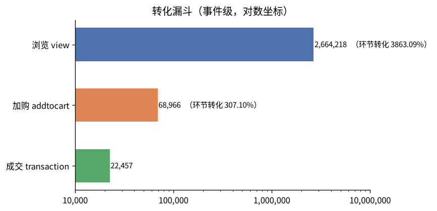

我是 **Yukai**，应用经济学本科在读。喜欢用 pandas 和 SQL 把杂乱的行为日志整理成能讲清楚的结论，也喜欢做那种**双击就能跑**的小工具。

## 最近在做

**电商用户行为分析**：276 万条真实行为日志、140 万访客，做转化漏斗、RFM 分层、K-Means 聚类和品类维度分析。

漏斗显示瓶颈在「浏览 → 加购」（2.6%），而不是支付环节；78% 的成交用户只买过一次，前 10% 用户贡献了近一半订单。

[看完整分析 →](https://github.com/z-Yukai/Analysis-of-E-commerce-User-Behavior) · [在线看图表](https://github.com/z-Yukai/Analysis-of-E-commerce-User-Behavior/tree/main/figs)

## 项目

**图灵实验室**：一个 HTML 文件，在浏览器里实时解 Gray-Scott 反应扩散方程。按住画布随手一抹，就能长出珊瑚、迷宫、斑马纹。零依赖、可离线。

[▶ 在线试玩 →](https://z-yukai.github.io/turing-lab/) · [看源码 →](https://github.com/z-Yukai/turing-lab)

## 我在用

| 工具 | 用来做什么 |
|---|---|
| **Python** | pandas / numpy 做清洗与建模，matplotlib / seaborn 画图 |
| **R** | ggplot2、tidyverse 做统计分析与可视化 |
| **SQL** | MySQL 取数、宽表加工、查询优化 |
| **SPSS** | 方差分析、回归、聚类等经典统计方法 |

## 关于我

- 🎓 本科在读，正在备考**应用经济学**研究生
- 📊 关注用户行为分析、RFM 建模、聚类与转化漏斗
- 🛠 相信「能复现的分析才有价值」：仓库里一律带下载脚本和抽样数据
- 📍 偶尔写点小工具，把想法做成能点开就跑的页面

## 联系

- GitHub：[z-Yukai](https://github.com/z-Yukai)
- 有问题欢迎开 Issue，比邮件快

---

这个主页的排版参考了 <a href="https://github.com/alchaincyf">花叔</a> 的页面结构。
